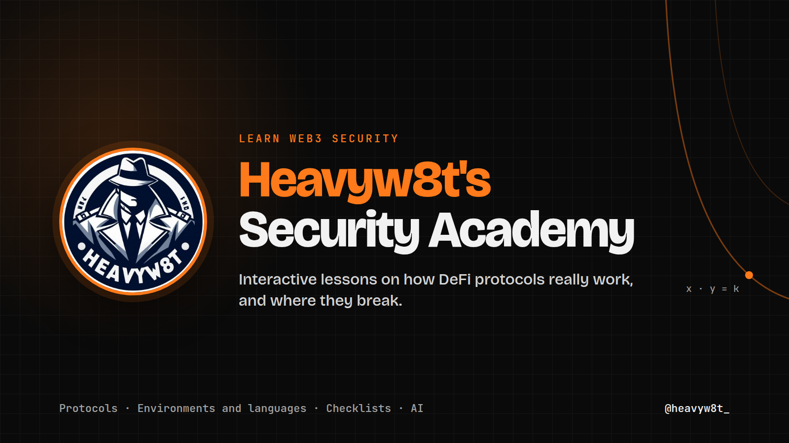

Home page of heavyw8t, independent web3 security researcher, and Heavyw8t's Security Academy: interactive lessons on how web3 protocols work and where they break, for auditors starting out, security researchers learning a new area, and developers who want to write safer code.

Live at [heavyw8t.github.io](https://heavyw8t.github.io), the academy at [heavyw8t.github.io/academy](https://heavyw8t.github.io/academy/). Content licensed under [CC BY 4.0](LICENSE).
